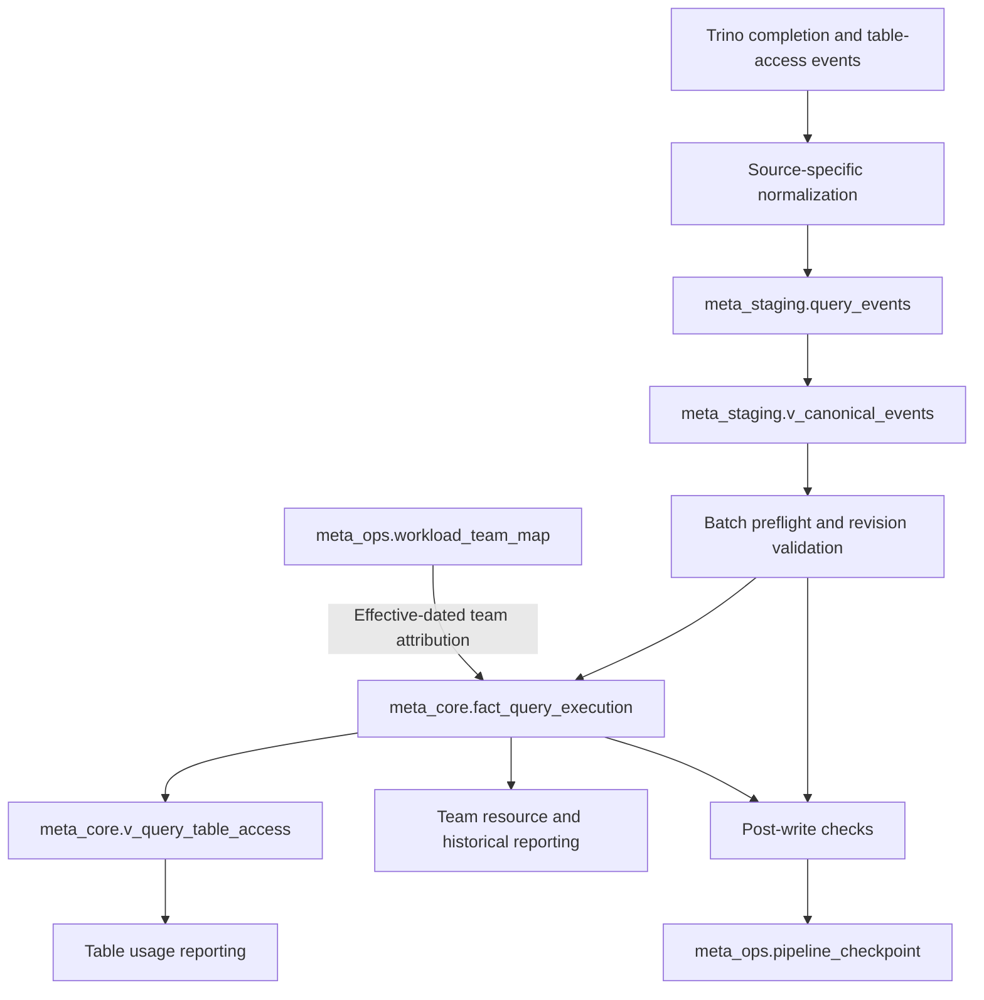

# Trino Usage Meta DWH

A reference design for analyzing historical Trino query usage with Apache Iceberg. It is intended to answer three questions:

- **Table usage:** Which authenticated principals accessed a table, and how did that change over time?

- **Team resource consumption:** How much CPU and I/O can be attributed to each workload team?

- **Historical changes:** How should reports handle late events, corrected query metadata, and changing workload ownership?

The key modeling choice is to store resource metrics once per query execution and expose table accesses separately. A query may touch several tables, but its CPU and I/O belong to the execution as a whole and must not be counted once per table.


## Architecture



The `iceberg` prefix in the SQL is an example Trino catalog. Within it, `meta_staging` contains incoming data, `meta_core` contains reporting objects, and `meta_ops` contains pipeline metadata.

## Data model

| Object | Logical grain | Responsibility |
| --- | --- | --- |
| `meta_staging.query_events` | One delivered event revision; replays are allowed. | Preserves normalized input, event versions, source references, timestamps, measures, and access metadata. |
| `meta_staging.v_canonical_events` | One canonical representation per delivered row. | Normalizes terminal state, sorts and deduplicates accesses, and calculates a versioned payload hash. |
| `meta_ops.workload_team_map` | One effective-dated workload/team assignment. | Preserves workload ownership intervals and mapping versions. |
| `meta_core.fact_query_execution` | One current row per `(cluster_id, query_id)`. | Stores accepted query metrics, the latest revision, access list, resolved team, and provenance. |
| `meta_core.v_query_table_access` | One query/table/access-role row. | Expands accesses for table-level reporting without duplicating stored measures. |
| `meta_ops.pipeline_checkpoint` | One row per pipeline. | Tracks the highest contiguous batch validated and published. |

A table-owner dimension is not required for these metrics. Dataset ownership and responsibility for query compute are different concepts. Add a separate table metadata dimension only if ownership or classification becomes a reporting requirement.

## Tables and views explained

### `meta_staging.query_events`: incoming query-event history

One row represents a delivered revision of a Trino query-completion event. The execution is identified by `(cluster_id, query_id)` and `event_version` identifies the revision. The row also contains `user_id`, `workload_id`, query state, start and end times, CPU, I/O and memory measures, and table accesses. Batch IDs, source references, and ingestion and normalization fields provide lineage.

Ingestion does not overwrite earlier deliveries when a retry or correction arrives. Staging can therefore contain repeated deliveries of the same revision. A staging row is not necessarily a distinct query. The table is partitioned by `ingestion_batch_seq` for batch processing.

`accesses` is an array of rows containing `catalog_name`, `schema_name`, `table_name`, and `access_role`. A query that reads two tables has two entries in the array, but its resource measures are still stored only once.

### `meta_staging.v_canonical_events`: comparable event payloads

This view uppercases the terminal query state, sorts and deduplicates access entries, and calculates `payload_hash` with a `hash_contract_version`. It preserves the event identifiers and provenance needed by validation and transformation.

Preflight compares hashes to identify different payloads claiming the same `(cluster_id, query_id, event_version)`. The view does not select the latest revision or remove repeated deliveries. Those decisions are made by validation and publishing.

### `meta_ops.workload_team_map`: historical workload ownership

Each row assigns a `workload_id` to a `team_id` for an effective-dated interval. `valid_from` is inclusive, `valid_to` is exclusive, and NULL `valid_to` means there is no specified end date. The row also records a mapping ID and version.

The user or service that submits a query may not be part of the team responsible for its compute usage. The publisher resolves the mapping valid at query end time and stores the selected team and mapping identifiers in the fact. Overlapping mappings are rejected. If no mapping exists, the team remains unknown rather than being guessed.

### `meta_core.fact_query_execution`: current corrected execution facts

This is the main physical reporting table, designed for one current row per `(cluster_id, query_id)`. It stores the highest accepted event version, query state, user, workload, resolved team, timestamps, `event_day`, CPU, physical input bytes, peak memory, access completeness, and the canonical access array. Source batch and publication fields show where the current row came from. The table is partitioned by `event_day` for time-based reporting.

The resource measures describe the whole execution, not individual tables. Storing them once at query grain lets team reports aggregate usage without multiplying it by the number of accesses. A newer authoritative revision replaces the current metrics and access list together through `MERGE`.

The fact represents current corrected history, not every delivered revision or a record of what a dashboard showed in the past. A correction can change an earlier period's results. Iceberg does not enforce the logical execution key, so the publisher must validate uniqueness and prevent concurrent writers.

### `meta_core.v_query_table_access`: table-level access view

This view expands the fact's `accesses` array with `UNNEST`, producing one row per query, catalog, schema, table, and access role. It also exposes execution context such as user, team, state, date, and access completeness.

Use it for questions such as “How many distinct principals read `orders` last month?” A query with no access entries produces no rows in this view, but remains in the fact table. Do not sum CPU or I/O after expanding accesses. Incomplete access metadata also means table-user counts represent observed usage, not necessarily total usage.

The view avoids maintaining a second physical access table. If table-access reporting becomes a performance bottleneck, a materialized access table is an option, but it would need its own correction and consistency process.

### `meta_ops.pipeline_checkpoint`: validated publication progress

This table stores one logical record per `pipeline_id`, including `last_batch_seq`, `last_batch_id`, and `updated_at`. A new installation starts the `trino_usage` pipeline at sequence zero if no checkpoint exists.

The publisher advances the checkpoint only after the fact `MERGE` and post-write checks pass. Fact and checkpoint writes are separate operations. If the fact update succeeds but checkpoint advancement fails, reconcile and retry the same sequence. Iceberg does not enforce checkpoint uniqueness or single-writer coordination, so the external runner must enforce both.

## Reporting semantics

The examples in [`sql/04_analytics_examples.sql`](sql/04_analytics_examples.sql) show the intended calculations:

- **Table users:** Count distinct non-null authenticated principals with observed `READ` access on `FINISHED` executions. Service accounts count as principals. Check access completeness when interpreting the result.

- **Team resources:** Sum CPU time and physical input bytes from `fact_query_execution`, including `FINISHED`, `FAILED`, and `CANCELED` executions. Keep unmapped workloads visible. Peak memory is a per-query maximum, so report a maximum or distribution rather than a sum.

- **Historical trends:** Group by execution date and team, or by table and date. Do not sum daily distinct-user counts to get a period-wide count.

Timestamps are normalized to UTC and stored as `TIMESTAMP(6)` without time zone. Reporting windows use half-open intervals, `[start, end)`. Late events are reported by query end time, not ingestion time.

## Running the reference SQL

**Prerequisites:** A reachable Trino instance with an Iceberg catalog named `iceberg`, permission to create the three schemas, and a source adapter that produces the normalized staging contract. The SQL files do not provide a complete raw-source adapter or automated integration test.

```bash
export TRINO_SERVER="http://localhost:8080"
trino --server "$TRINO_SERVER" --file sql/00_schema.sql
```

Load approved team mappings and an event batch into `meta_staging.query_events`. The [`sql/00b_ingest_adapter_template.sql`](sql/00b_ingest_adapter_template.sql) uses placeholders because the raw Trino event fields were not provided. It cannot be executed unchanged. The [`sql/00c_team_mapping_example.sql`](sql/00c_team_mapping_example.sql) is illustrative, not authoritative ownership data.

For each batch, run these steps in order:

1. **Preflight:** Replace `__BATCH_SEQ__` in `sql/01_preflight.sql` and run it. Stop if it returns any rows. A zero Trino CLI exit code is not sufficient validation.

1. **Publish:** Run `sql/02_transform.sql` with the same batch sequence.

1. **Post-write checks:** Run `sql/05_post_write_checks.sql`. Stop if it returns any rows.

1. **Checkpoint:** Replace `__BATCH_SEQ__` and `__BATCH_ID__` in `sql/03_advance_checkpoint.sql`. The batch ID must be a quoted SQL string, such as `'batch_001'`. Confirm exactly one row was updated.

For example, to prepare preflight for batch sequence 1:

```bash
BATCH_SEQ=1
sed "s/__BATCH_SEQ__/${BATCH_SEQ}/g" sql/01_preflight.sql > /tmp/preflight.sql
trino --server "$TRINO_SERVER" --file /tmp/preflight.sql
```

This prints the validation results but does not automatically abort the workflow if rows are returned. A production runner must check the results, stop on violations, serialize publishers, and verify checkpoint updates.

## Limits and next steps

Before production use, validate the model and SQL on the intended Trino/Iceberg deployment. Test duplicate deliveries, same-version conflicts, higher-version corrections, incomplete accesses, changes in team ownership, updates that move a query between date partitions, checkpoint retries, and hash-contract upgrades. Production deployment also needs access controls, identity protection, monitoring, retention rules, and an assigned owner.

The goal is straightforward: count each execution's resource use once, make table access easy to analyze, and show where the data or attribution is incomplete.
